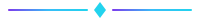

<!--
  Full Stack Developer · Cybersecurity Enthusiast · AI Builder · Python Developer · JavaScript · React · Node.js · Express.js · MongoDB · PostgreSQL · Linux · OSINT · Firewall · Automation · Open Source · GitHub
-->

  

    

      
        
      HELLO, I'M
       
      LUCKY JOSHI
       
      

      
    

  

 

<table align="center" border="0" cellspacing="0" cellpadding="0">
  <tbody>
    <tr>
      <td align="center" valign="middle">
        
      </td>
      <td align="center" valign="middle">
        
      </td>
      <td align="center" valign="middle">
        
      </td>
      <td align="center" valign="middle">
        
      </td>
      <td align="center" valign="middle">
        
      </td>
      <td align="center" valign="middle">
        
      </td>
    </tr>
  </tbody>
</table>

 

  
  
  
  

 

  

---

## 👨‍💻 About Me

<table border="0" cellspacing="14" cellpadding="0" width="100%">
  <tbody>
    <tr>
      <td width="38%" valign="top" align="center" style="background:#10142b;border-radius:22px;border:1px solid #232749;padding:26px 20px;">
        
👋

        <b style="font-size:24px;color:#ffffff;">Lucky Joshi</b>
         
        Full-Stack Developer & AI Builder
          
        🎓 BSc Physical Science (CS) 
        University of Delhi 
        📍 India
      </td>
      <td width="62%" valign="middle" align="left" style="background:#10142b;border-radius:22px;border:1px solid #232749;padding:26px 26px;">
        <b style="font-size:18px;color:#38bdf8;">Building intelligent systems that solve real problems.</b>
          
        
          Passionate full-stack developer and AI enthusiast with a growing focus on cybersecurity.
          I love turning ambitious ideas into polished, working products — from edu-tech platforms
          and e-commerce rails to Linux security tooling and OSINT intelligence pipelines.
        
          
        <table border="0" cellspacing="8" cellpadding="0" width="100%">
          <tbody>
            <tr>
              <td style="padding:8px 12px;border-radius:14px;background:#0a0d1a;border:1px solid #232749;">💻 <b style="color:#ffffff;">Full Stack</b> Developer</td>
              <td style="padding:8px 12px;border-radius:14px;background:#0a0d1a;border:1px solid #232749;">🛡 <b style="color:#ffffff;">Cybersecurity</b> Enthusiast</td>
            </tr>
            <tr>
              <td style="padding:8px 12px;border-radius:14px;background:#0a0d1a;border:1px solid #232749;">🤖 <b style="color:#ffffff;">AI</b> Builder</td>
              <td style="padding:8px 12px;border-radius:14px;background:#0a0d1a;border:1px solid #232749;">🚀 <b style="color:#ffffff;">Open Source</b> Builder</td>
            </tr>
          </tbody>
        </table>
         
        ❤️ Solving real-world problems, one commit at a time.
      </td>
    </tr>
  </tbody>
</table>

 

  

---

## 🎯 Current Focus

<table border="0" cellspacing="14" cellpadding="0" width="100%">
  <tbody>
    <tr>
      <td width="33%" valign="top" align="center" style="background:#10142b;border-radius:24px;border:1px solid #232749;padding:24px 18px;">
        🔭
        <h3 style="color:#38bdf8;margin:10px 0 6px 0;font-size:18px;">Currently Building</h3>
        SentinelFW
        IntelXtract
        SkillSwap
        Mentixo AI
      </td>
      <td width="33%" valign="top" align="center" style="background:#10142b;border-radius:24px;border:1px solid #232749;padding:24px 18px;">
        🌱
        <h3 style="color:#22d3ee;margin:10px 0 6px 0;font-size:18px;">Currently Learning</h3>
        AI & Machine Learning
        Cybersecurity
        System Design
        Cloud
        Backend Engineering
        Open Source
      </td>
      <td width="33%" valign="top" align="center" style="background:#10142b;border-radius:24px;border:1px solid #232749;padding:24px 18px;">
        🎯
        <h3 style="color:#a78bfa;margin:10px 0 6px 0;font-size:18px;">Future Goal</h3>
        
          Become a <b style="color:#ffffff;">Security Engineer</b> and <b style="color:#ffffff;">Full Stack Developer</b>
          building powerful, secure and impactful products.
        
      </td>
    </tr>
  </tbody>
</table>

 

  

---

## 🛠️ Tech Stack

<table border="0" cellspacing="14" cellpadding="0" width="100%">
  <tbody>
    <tr>
      <td width="33%" valign="top" align="center" style="background:#10142b;border-radius:24px;border:1px solid #232749;padding:24px 14px;">
        <h3 style="color:#38bdf8;margin:4px 0 12px 0;font-size:17px;">🎨 Frontend</h3>
        

          
        

      </td>
      <td width="33%" valign="top" align="center" style="background:#10142b;border-radius:24px;border:1px solid #232749;padding:24px 14px;">
        <h3 style="color:#22d3ee;margin:4px 0 12px 0;font-size:17px;">⚙️ Backend</h3>
        

          
        

      </td>
      <td width="33%" valign="top" align="center" style="background:#10142b;border-radius:24px;border:1px solid #232749;padding:24px 14px;">
        <h3 style="color:#a78bfa;margin:4px 0 12px 0;font-size:17px;">🗄️ Databases</h3>
        

          
        

      </td>
    </tr>
    <tr>
      <td width="33%" valign="top" align="center" style="background:#10142b;border-radius:24px;border:1px solid #232749;padding:24px 14px;">
        <h3 style="color:#f472b6;margin:4px 0 12px 0;font-size:17px;">💬 Languages</h3>
        

          
        

      </td>
      <td width="33%" valign="top" align="center" style="background:#10142b;border-radius:24px;border:1px solid #232749;padding:24px 14px;">
        <h3 style="color:#4ade80;margin:4px 0 12px 0;font-size:17px;">🛠️ Tools</h3>
        

          
        

      </td>
      <td width="33%" valign="top" align="center" style="background:#10142b;border-radius:24px;border:1px solid #232749;padding:24px 14px;">
        <h3 style="color:#fbbf24;margin:4px 0 12px 0;font-size:17px;">🧠 Special Interest</h3>
        

          
        

        nftables · OSINT · Security Automation · Linux
      </td>
    </tr>
  </tbody>
</table>

 

  

---

## 🚀 Featured Projects

<table border="0" cellspacing="14" cellpadding="0" width="100%">
  <tbody>
    <tr>
      <td width="50%" valign="top" style="background:#10142b;border-radius:26px;border:1px solid #232749;overflow:hidden;">
        

          🛡️
        

        

          <h3 style="margin:0 0 6px 0;color:#ffffff;font-size:19px;">SentinelFW</h3>
          Linux firewall manager & security monitor built with Python + nftables. Preview-first, YAML-driven rules with plain-English logging in SQLite.
            
          Python
          nftables
          SQLite
          YAML
            
          🟢 ACTIVE
            
          

            • Preview exact <b style="color:#ffffff;">nft script</b> before touching the kernel 
            • Every change <b style="color:#ffffff;">previewed, backed up, confirmed</b> 
            • Owns only its <b style="color:#ffffff;">nftables</b> table 
            • Logs stored in <b style="color:#ffffff;">SQLite</b>, explained in plain English
          

          &nbsp;
          &nbsp;
          
            
          <a href="https://github.com/Lucky-Joshi/SentinelFW" target="_blank" rel="noopener noreferrer" style="display:inline-block;padding:10px 22px;border-radius:14px;background:linear-gradient(135deg,#7c3aed,#00d4ff);color:#ffffff;text-decoration:none;font-weight:700;font-size:14px;">View on GitHub</a>
        

      </td>
      <td width="50%" valign="top" style="background:#10142b;border-radius:26px;border:1px solid #232749;overflow:hidden;">
        

          🔍
        

        

          <h3 style="margin:0 0 6px 0;color:#ffffff;font-size:19px;">IntelXtract</h3>
          AI-powered OSINT automation & intelligence platform that unifies public-source data collection into one interface.
            
          AI
          OSINT
          Python
            
          🟢 ACTIVE
            
          

            • WHOIS, DNS, SSL, HTTP, IP, email & social enumeration 
            • CT logs, archives & news <b style="color:#ffffff;">correlation</b> 
            • Normalizes data into <b style="color:#ffffff;">one unified interface</b> 
            • Visualize + report intelligence automatically
          

          &nbsp;
          &nbsp;
          
            
          <a href="https://github.com/Lucky-Joshi/IntelXtract" target="_blank" rel="noopener noreferrer" style="display:inline-block;padding:10px 22px;border-radius:14px;background:linear-gradient(135deg,#38bdf8,#7c3aed);color:#ffffff;text-decoration:none;font-weight:700;font-size:14px;">View on GitHub</a>
        

      </td>
    </tr>
    <tr>
      <td width="50%" valign="top" style="background:#10142b;border-radius:26px;border:1px solid #232749;overflow:hidden;">
        

          🔁
        

        

          <h3 style="margin:0 0 6px 0;color:#ffffff;font-size:19px;">SkillSwap</h3>
          AI-powered peer learning & skill exchange platform for colleges — verified profiles, smart matching, chat & certificates.
            
          Full Stack
          AI
          Real-time Chat
            
          

            • AI-generated <b style="color:#ffffff;">mentor/learner/peer</b> recommendations 
            • Verified student profiles & skill listing 
            • Real-time chat + <b style="color:#ffffff;">session scheduling</b> 
            • <b style="color:#ffffff;">Badges & certificates</b> for growth
          

          &nbsp;
          &nbsp;
          
            
          <a href="https://github.com/Lucky-Joshi/SkillSwap" target="_blank" rel="noopener noreferrer" style="display:inline-block;padding:10px 22px;border-radius:14px;background:linear-gradient(135deg,#00d4ff,#7c3aed);color:#ffffff;text-decoration:none;font-weight:700;font-size:14px;">View on GitHub</a>
          <a href="https://skill-swap-nine-lac.vercel.app" target="_blank" rel="noopener noreferrer" style="display:inline-block;padding:10px 22px;border-radius:14px;background:linear-gradient(135deg,#7c3aed,#00d4ff);color:#ffffff;text-decoration:none;font-weight:700;font-size:14px;">Live Demo</a>
        

      </td>
      <td width="50%" valign="top" style="background:#10142b;border-radius:26px;border:1px solid #232749;overflow:hidden;">
        

          🤖
        

        

          <h3 style="margin:0 0 6px 0;color:#ffffff;font-size:19px;">Mentixo AI</h3>
          AI-powered educational platform generating study materials, quizzes and interactive learning experiences.
            
          Full Stack
          Supabase
          Prisma
            
          &nbsp;
          &nbsp;
          
            
          

            • <b style="color:#ffffff;">15+ core features</b> — quiz generation & automated summaries 
            • Study material generation 
            • Interactive learning experiences
          

          <a href="https://github.com/Lucky-Joshi/Mentixo-AI" target="_blank" rel="noopener noreferrer" style="display:inline-block;padding:10px 22px;border-radius:14px;background:linear-gradient(135deg,#38bdf8,#00d4ff);color:#ffffff;text-decoration:none;font-weight:700;font-size:14px;">View on GitHub</a>
          <a href="https://mentixo.netlify.app/" target="_blank" rel="noopener noreferrer" style="display:inline-block;padding:10px 22px;border-radius:14px;background:linear-gradient(135deg,#00d4ff,#38bdf8);color:#ffffff;text-decoration:none;font-weight:700;font-size:14px;">Live Demo</a>
        

      </td>
    </tr>
  </tbody>
</table>

 

  

---

## 🛡️ Cybersecurity

<table border="0" cellspacing="14" cellpadding="0" width="100%">
  <tbody>
    <tr>
      <td width="50%" valign="top" align="center" style="background:#10142b;border-radius:24px;border:1px solid #232749;padding:26px 20px;">
        🔐
        <h3 style="color:#a78bfa;margin:10px 0 14px 0;font-size:18px;">Security Tooling & Focus</h3>
        Linux
        Python
        Network Security
        OSINT
        Security Automation
        Firewall
      </td>
      <td width="50%" valign="top" align="center" style="background:#10142b;border-radius:24px;border:1px solid #232749;padding:26px 20px;">
        📈
        <h3 style="color:#38bdf8;margin:10px 0 14px 0;font-size:18px;">Security Learning Journey</h3>
        

          🛡️ Building <b style="color:#ffffff;">SentinelFW</b> — a safe, preview-first nftables firewall manager 
          🔍 Building <b style="color:#ffffff;">IntelXtract</b> — automated OSINT intelligence platform 
          🐧 Deepening hands-on <b style="color:#ffffff;">Linux</b> & network security 
          🎓 Pursuing <b style="color:#ffffff;">future cybersecurity certifications</b> 
          ⚡ Automating security workflows with <b style="color:#ffffff;">Python</b>
        

      </td>
    </tr>
  </tbody>
</table>

 

  

---

## 🌍 Open Source

<table border="0" cellspacing="14" cellpadding="0" width="100%">
  <tbody>
    <tr>
      <td width="33%" valign="top" align="center" style="background:#10142b;border-radius:24px;border:1px solid #232749;padding:26px 18px;">
        🌱
        <h3 style="color:#38bdf8;margin:10px 0 6px 0;font-size:17px;">Learning in Public</h3>
        Sharing my journey, code and lessons as I build.
      </td>
      <td width="33%" valign="top" align="center" style="background:#10142b;border-radius:24px;border:1px solid #232749;padding:26px 18px;">
        🧰
        <h3 style="color:#22d3ee;margin:10px 0 6px 0;font-size:17px;">Useful Software</h3>
        Focused on tools that genuinely solve real problems.
      </td>
      <td width="33%" valign="top" align="center" style="background:#10142b;border-radius:24px;border:1px solid #232749;padding:26px 18px;">
        🤝
        <h3 style="color:#a78bfa;margin:10px 0 6px 0;font-size:17px;">Collaboration</h3>
        Open to partnering on AI, EdTech & security projects.
      </td>
    </tr>
  </tbody>
</table>

 

  

---

## ⚡ GitHub Analytics

  

  
  

  

  
  

  

  

  

 

  

---

## 🏆 Highlights

<table border="0" cellspacing="14" cellpadding="0" width="100%">
  <tbody>
    <tr>
      <td width="33%" valign="top" align="center" style="background:#10142b;border-radius:24px;border:1px solid #232749;padding:22px 14px;">
        📦
        <h3 style="color:#38bdf8;margin:8px 0 4px 0;font-size:17px;">Repositories</h3>
        
      </td>
      <td width="33%" valign="top" align="center" style="background:#10142b;border-radius:24px;border:1px solid #232749;padding:22px 14px;">
        🚀
        <h3 style="color:#22d3ee;margin:8px 0 4px 0;font-size:17px;">Featured Projects</h3>
        5 flagship builds
      </td>
      <td width="33%" valign="top" align="center" style="background:#10142b;border-radius:24px;border:1px solid #232749;padding:22px 14px;">
        🛡️
        <h3 style="color:#a78bfa;margin:8px 0 4px 0;font-size:17px;">Cybersecurity Projects</h3>
        2 security tools
      </td>
    </tr>
    <tr>
      <td width="33%" valign="top" align="center" style="background:#10142b;border-radius:24px;border:1px solid #232749;padding:22px 14px;">
        🤖
        <h3 style="color:#38bdf8;margin:8px 0 4px 0;font-size:17px;">AI Projects</h3>
        3 AI-powered builds
      </td>
      <td width="33%" valign="top" align="center" style="background:#10142b;border-radius:24px;border:1px solid #232749;padding:22px 14px;">
        🌍
        <h3 style="color:#22d3ee;margin:8px 0 4px 0;font-size:17px;">Open Source</h3>
        Active 
        continually shipping
      </td>
      <td width="33%" valign="top" align="center" style="background:#10142b;border-radius:24px;border:1px solid #232749;padding:22px 14px;">
        🎓
        <h3 style="color:#a78bfa;margin:8px 0 4px 0;font-size:17px;">Learning Journey</h3>
        ∞ always growing
      </td>
    </tr>
  </tbody>
</table>

 

  

---

## 🗺️ My Journey

  

<table border="0" cellspacing="10" cellpadding="0" width="80%">
  <tbody>
    <tr>
      <td align="center" style="background:#10142b;border-radius:16px;border:1px solid #232749;padding:12px;">
        💡 
        <b style="color:#38bdf8;">Started Programming</b>
      </td>
      <td align="center" style="color:#22d3ee;font-weight:800;font-size:18px;">↓</td>
      <td align="center" style="background:#10142b;border-radius:16px;border:1px solid #232749;padding:12px;">
        🌐 
        <b style="color:#22d3ee;">Web Development</b>
      </td>
      <td align="center" style="color:#22d3ee;font-weight:800;font-size:18px;">↓</td>
      <td align="center" style="background:#10142b;border-radius:16px;border:1px solid #232749;padding:12px;">
        🤖 
        <b style="color:#a78bfa;">AI & ML</b>
      </td>
    </tr>
    <tr>
      <td align="center" style="background:#10142b;border-radius:16px;border:1px solid #232749;padding:12px;">
        🛡️ 
        <b style="color:#7dd3fc;">Cybersecurity</b>
      </td>
      <td align="center" style="color:#22d3ee;font-weight:800;font-size:18px;">↓</td>
      <td align="center" style="background:#10142b;border-radius:16px;border:1px solid #232749;padding:12px;">
        🌍 
        <b style="color:#34d399;">Open Source</b>
      </td>
      <td align="center" style="color:#22d3ee;font-weight:800;font-size:18px;">↓</td>
      <td align="center" style="background:#10142b;border-radius:16px;border:1px solid #232749;padding:12px;">
        🧰 
        <b style="color:#fbbf24;">Building Developer Tools</b>
      </td>
    </tr>
    <tr>
      <td colspan="5" align="center" style="color:#22d3ee;font-weight:800;font-size:18px;">↓</td>
    </tr>
    <tr>
      <td colspan="5" align="center" style="background:linear-gradient(135deg,#7c3aed,#00d4ff);border-radius:16px;border:1px solid #ffffff44;padding:16px;">
        🛡️🔮 
        <b style="color:#ffffff;font-size:18px;">Future: Security Engineer → Full Stack Developer</b>
      </td>
    </tr>
  </tbody>
</table>

 

  

---

## 💬 Dev Quote

<table border="0" cellspacing="0" cellpadding="0" width="100%">
  <tbody>
    <tr>
      <td align="center" style="background:#10142b;border-radius:26px;border:1px solid #232749;padding:40px 30px;background-image:linear-gradient(rgba(124,58,237,0.08),rgba(0,212,255,0.08));">
        ❝
        

          "Code is the closest thing we have to magic.  Build boldly, learn endlessly, and create the future."
        

        — Lucky Joshi
          
        
      </td>
    </tr>
  </tbody>
</table>

 

  

---

## 🤝 Support My Work

<table border="0" cellspacing="0" cellpadding="0">
  <tbody>
    <tr>
      <td align="center" style="padding:6px;"></td>
      <td align="center" style="padding:6px;"></td>
      <td align="center" style="padding:6px;"></td>
      <td align="center" style="padding:6px;"></td>
    </tr>
  </tbody>
</table>

 

  

  

    Thank you for visiting 🚀
  

  

    Built with 💜 &nbsp;·&nbsp; Happy Coding! &nbsp;·&nbsp; © 2026 Lucky Joshi
  

